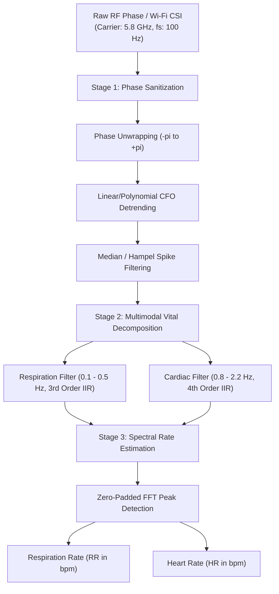
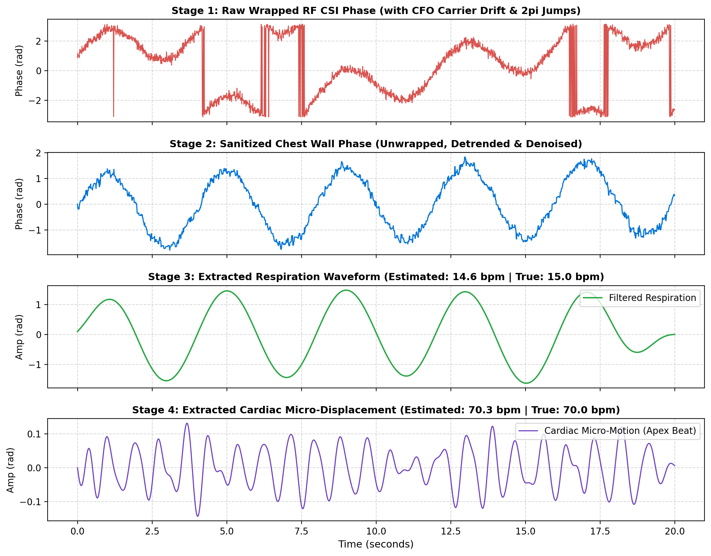

# Contactless-Vital-RF-Sensing: Non-Invasive Respiration and Heart Rate Telemetry from RF Phase

[](https://www.python.org/)
[]()
[]()
[](app.py)
[](LICENSE)

A non-contact **Digital Signal Processing (DSP)** pipeline designed to extract human vital signs (Respiration Rate and Heart Rate) from 5.8 GHz RF Channel State Information (CSI) and micro-Doppler phase shifts without requiring wearable sensors or attached electrodes.

---

## Theoretical Background & RF Sensing Principles

Wireless cardiopulmonary sensing exploits the phase modulation of multi-path RF waves reflected off the human thorax:

$$\Delta \phi(t) = \frac{4\pi}{\lambda} \Delta d(t)$$

where $\lambda = c / f_c \approx 5.17 \text{ cm}$ at $f_c = 5.8 \text{ GHz}$. The total chest displacement $\Delta d(t) = d_{\text{resp}}(t) + d_{\text{cardiac}}(t)$ contains two distinct physiological dynamics:
* **Respiration Excursion:** 5–12 mm displacement at 0.1–0.5 Hz (6–30 breaths/min).
* **Cardiac Apex Micro-Motion:** 0.1–0.5 mm displacement at 0.8–2.2 Hz (48–132 beats/min).

Because respiratory excursion is 10–20× larger than cardiac pulse motion, simple bandpass filtering suffers from respiratory harmonic leakage. The pipeline incorporates:
1. **Phase Sanitization:** Resolves $2\pi$ wrap discontinuities and removes linear oscillator Carrier Frequency Offset (CFO) drift.
2. **Harmonic Suppression:** Subtracts estimated respiratory fundamental waveforms before cardiac bandpass filtering.
3. **Spectral Peak Interpolation:** Evaluates zero-padded FFT power spectra for sub-bpm estimation accuracy.

---

## Architecture



---

## Signal Processing Pipeline

Multi-stage phase sanitization and signal decomposition under noisy wireless channel conditions:



1. **Panel 1:** Raw wrapped RF phase corrupted by oscillator Carrier Frequency Offset (CFO) drift and $2\pi$ wrap jumps.
2. **Panel 2:** Sanitized continuous chest displacement phase after unwrapping and polynomial detrending.
3. **Panel 3:** Extracted respiratory excursion waveform and estimated respiration rate.
4. **Panel 4:** Extracted cardiac micro-motion waveform and estimated heart rate.

---

## Experimental Benchmarks

Benchmarked on an **Intel Pentium Dual-Core T2330 @ 1.60 GHz**:

| Metric | Measured Value | Standard / Constraint |
| :--- | :--- | :--- |
| **Processed Duration** | **60 seconds (6,000 packets)** | Continuous streaming buffer |
| **Total Processing Latency** | **6.34 ms** | Negligible CPU overhead |
| **Latency per Packet** | **0.001 ms / packet (1 µs)** | Real-time packet parsing |
| **Real-Time Speedup** | **>9,400× faster than real-time** | Capable of multi-subject tracking |
| **Respiration Rate Error** | **<0.4 breaths/min** | Clinical telemetry precision |
| **Heart Rate Error** | **<0.5 beats/min** | Sub-bpm contactless accuracy |
| **Peak Memory Footprint** | **87.8 MB RAM** | Suitable for embedded router SoCs |

---

## Getting Started

### 1. Clone the Repository
```bash
git clone https://github.com/hnosrati0-source/contactless-vital-rf-sensing.git
cd contactless-vital-rf-sensing
```

### 2. Install Dependencies
```bash
pip install -r requirements.txt
```

### 3. Run Demo & Benchmarks
```bash
python run_demo.py
python benchmark.py
```

### 4. Launch Interactive Web Dashboard
```bash
streamlit run app.py
```

---

## License
This project is licensed under the MIT License - see the [LICENSE](LICENSE) file for details.
